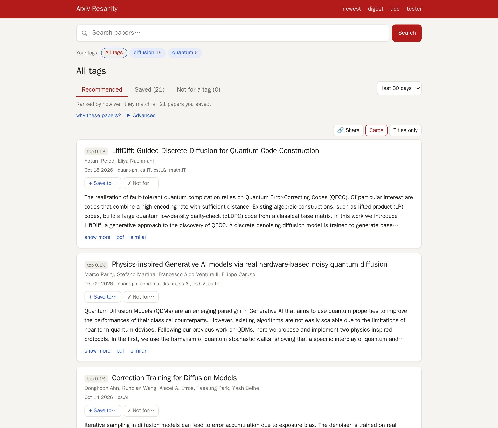

# Arxiv Resanity

Arxiv Resanity keeps up with arXiv for you. You save papers you like into tags, one per topic you follow, and it ranks every new paper against each tag. It trains a small model per tag on the spot, using tfidf features plus dense embeddings of titles and abstracts. Each paper you mark as not relevant improves that tag's ranking. Every Sunday it can email you a digest of the week's best papers per tag, which you rate with one click. Search, browse and add papers by link, from any year.

It is a fork of Andrej Karpathy's [arxiv-sanity-lite](https://github.com/karpathy/arxiv-sanity-lite). Compared to the original, it adds embeddings, tuned with an evaluation on real user ratings, as well as:
- downvotes;
- bulk import of years of papers;
- password accounts and read-only sharing;
- the weekly digest;
- self-hosted deployment with docker compose.



#### To run

To run this locally I usually run the following script to update the database with any new papers. I typically schedule this via a periodic cron job:

```bash
#!/bin/bash

uv run python arxiv_daemon.py --num 2000

if [ $? -eq 0 ]; then
    echo "New papers detected! Running compute.py"
    uv run python compute.py
else
    echo "No new papers were added, skipping feature computation"
fi
```

You can see that updating the database is a matter of first downloading the new papers via the arxiv api using `arxiv_daemon.py`, and then running `compute.py` to compute the tfidf features of the papers. Finally to serve the flask server locally we'd run something like:

```bash
uv run flask --app serve run
```

All of the database will be stored inside the `data` directory. Finally, if you'd like to run your own instance on the interwebs I recommend simply running the above on a [Linode](https://www.linode.com), e.g. I am running this code currently on the smallest "Nanode 1 GB" instance indexing about 30K papers, which costs $5/month.

(Optional) Finally, `send_emails.py` sends the weekly digest emails over SMTP; see "Weekly digest" below.

#### Serve it publicly (Docker)

`docker-compose.yml` runs two services that share the data directory:
- **web:** gunicorn, listening on `127.0.0.1:8000`.
- **updater:** once a day, fetches new papers and recomputes the features. The web service picks up the new ones without a restart.

TLS is left to a reverse proxy in front.

```bash
cp .env.example .env        # DATA_PATH, port, signups, embedding model, HF token
docker compose up -d --build
docker compose logs -f updater
```

`DATA_PATH` can point at a corpus prepared on the host, for example `./data/5y` from `import_snapshot.py` with embeddings from `gpu_embed.sh`. The updater then only embeds each day's new papers, on CPU. `EMBED_MODEL` has to match the model that corpus was embedded with, or the next run re-embeds every paper. `HF_TOKEN` is only needed for gated models; EmbeddingGemma 2 downloads without one.

Accounts have passwords. With `ALLOW_SIGNUP=1`, anyone can create one. A username that has tags from before passwords existed is claimed by the first password set for it. With `ALLOW_SIGNUP=0`, create accounts yourself:

```bash
docker compose exec web flask --app serve set-password alice
```

Read-only sharing: users can turn on "let anyone view my tags read-only" on their profile (off by default). Anyone can then log in as them with an empty password and browse their tags, recommendations and digest. A viewer can't change anything, and never sees the email address. Turning it off ends those sessions on their next request.

Example nginx config for the proxy. The `X-Forwarded-*` headers are required, because the app takes the scheme, host and client IP from them (`TRUST_PROXY=1`), and session cookies are https-only (`SECURE_COOKIES=1`):

```nginx
# in the http block: at most 10 login attempts a minute per client
limit_req_zone $binary_remote_addr zone=asl_login:10m rate=10r/m;

server {
    listen 443 ssl;
    server_name sanity.example.org;
    # ssl_certificate ... as usual

    location / {
        proxy_pass http://127.0.0.1:8000;
        proxy_set_header Host $host;
        proxy_set_header X-Forwarded-For $proxy_add_x_forwarded_for;
        proxy_set_header X-Forwarded-Proto $scheme;
        proxy_set_header X-Forwarded-Host $host;
        proxy_read_timeout 120s;
    }
    location = /login {
        limit_req zone=asl_login burst=5 nodelay;
        proxy_pass http://127.0.0.1:8000;
        proxy_set_header Host $host;
        proxy_set_header X-Forwarded-For $proxy_add_x_forwarded_for;
        proxy_set_header X-Forwarded-Proto $scheme;
        proxy_set_header X-Forwarded-Host $host;
    }
}
```

Rate limits: generous per-client limits apply to the requests that cost CPU. A client is the logged-in user, else the IP address. Past a limit, the server answers 429 with a Retry-After header.

| request | limit |
|---|---|
| ranking by tag or by a paper | 120 a minute |
| search | 240 a minute |
| login attempts | 30 per 5 minutes, per IP and per username |
| add papers | 60 an hour, plus the arXiv fetch caps above |

Ordinary page views are never limited. The limits are counted in memory per worker, so with N workers a client can get up to N times the limit. Edit `RATE_LIMITS` in `serve.py` to change them, or set `RATE_LIMITS=0` to turn them off. The nginx `limit_req` for `/login` above is optional on top.

Backup: once a day the updater writes one consistent copy of `users.sqlite` (accounts, tags, votes: the only data that can't be rebuilt; KBs to a few MB) to `data/backups/users.sqlite`, replacing the previous copy. Copy it off the VPS however you like. Everything else can be rebuilt: papers from the snapshot and arXiv, features with `compute.py`.

Memory: the features are memory-mapped, so all workers share one copy in the page cache, and each worker adds about 0.5 GB on five years of papers. The whole 460k-paper setup runs in 2–3 GB of RAM. `WEB_THREADS` adds concurrency without adding memory.

#### Weekly digest

Once a week, every user with an email address on their profile gets the best new papers for each of their tags. The ranking is the same as the tag pages, restricted to the last 7 days and leaving out papers they already rated. The email links to `/digest`, which shows the same papers with one-click 👍 ("more like this") and 👎 ("not for me") buttons. Votes go straight into the tag, so the next digest improves. Every email has an unsubscribe link, including the one-click kind Gmail looks for.

In docker, the updater sends the digest every Sunday at 08:00 German time (`DIGEST_SCHEDULE=sun 08:00 Europe/Berlin`, summer time included). It's off by default; set `DIGEST_ENABLED=1` once sending works (step 5 below). The first digest then goes out at the next Sunday slot, never on the spot. Set `PUBLIC_URL` (your site, for the links) and `MAIL_FROM` in `.env`. To try it without sending anything: `uv run python send_emails.py --dry-run 1 -u <user> --save digest.html`. Without email, users can still open `/digest` and make one on the spot.

**Sending from your own VPS.** The `mail` service (`COMPOSE_PROFILES=mail`) is an outgoing-only Postfix that signs mail with DKIM and delivers straight to recipients' mail servers. It publishes no port, so only the updater can hand it mail. You need:
1. A VPS whose provider allows outgoing port 25. Check with `timeout 5 bash -c '</dev/tcp/gmail-smtp-in.l.google.com/25' && echo open`. Some providers unblock it on request.
2. Reverse DNS of the VPS's IP set to `MAIL_HOSTNAME` (in the provider's panel), with an A record for that name pointing back to the IP.
3. `MAIL_DOMAIN` (the domain in `MAIL_FROM`) and `MAIL_HOSTNAME` in `.env`, then `docker compose up -d`.
4. The DNS records the mail container prints on its first start (`docker compose logs mail`): DKIM, SPF and DMARC. The DKIM key lives in the `mail-dkim` volume, so the record stays valid across rebuilds.
5. A test: send yourself a digest (`docker compose exec updater python send_emails.py -u <you>`), and check the score at mail-tester.com or the "Authentication-Results" header (expect `spf=pass dkim=pass`). Only then set `DIGEST_ENABLED=1`. Mail that goes out before the DNS records exist lands in spam and costs the new server reputation.

New servers have no reputation, so the first digests may land in spam until recipients mark them as not spam. To send through an existing SMTP server instead (your provider's, a university relay, a sending service), drop the profile and set `SMTP_HOST`/`SMTP_PORT`/`SMTP_TLS`/`SMTP_USER`/`SMTP_PASSWORD`. Or keep the container and set `RELAYHOST` to route its mail through such a server, still DKIM-signed.

#### Tag check

A tag's page has a "Check how well this tag hangs together" button. Each liked paper is ranked by a model trained on the tag's other papers (5 folds, so 5 fits), and the page reports where a typical one lands. It lists the papers that land outside the top 10%: those are either saved to the wrong tag or a side topic. Afterwards, saved papers in the list show their held-out rank ("fits diffusion: top 0.2% when held out"), and every ranked paper shows its rank among all papers ("top 0.3%") instead of the raw model score.

Calibration on the Scholar Inbox ratings:
- One person's likes: 8.8% land outside the top 10% when held out.
- The main topic of a two-topic tag: 7.2% do.
- A side topic a quarter the size: 32.5% do.

Splitting such a tag is worth it. In a shared tag, 21% of the side topic's held-out papers made the top 1%; with a model of its own, 34% did. That's why the check suggests a separate tag once three or more papers don't fit.

#### Add papers by link

Logged-in users get an **add** page (`/import`). Paste arXiv links or ids there, one per line and up to 100 at a time. It understands abs/pdf links, Hugging Face and alphaXiv paper pages, DOIs and bare ids, and can tag the papers in the same step. Papers of any year or category work. The ones that aren't in the database yet are fetched from the arXiv API in one call per 100 ids:
- At most one call every 3.5 s across all server processes.
- At most `FETCH_LIMIT_USER` (200) fetched papers per user per day, and `FETCH_LIMIT_TOTAL` (2000) for everyone together.

A new paper counts for recommendations once its features are computed. The docker updater does that within `COMPUTE_MIN_INTERVAL` (an hour); without docker, it happens at the next `compute.py` run. Pasting an arXiv link into the search box also shows that paper first.

Old-style ids (hep-th/0408218) aren't supported.

#### Upgrading from the sqlitedict storage

Data from before the move to plain SQLite (`papers.db`, `dict.db`, `embeddings.db`, `features.p`) has to be converted once. The script only reads the old files:

```bash
uv run python migrate_db.py                            # data/
ARXIV_SANITY_DATA=data/5y uv run python migrate_db.py  # each other corpus
```

#### Requirements

Dependencies are managed with [uv](https://docs.astral.sh/uv/). This creates `.venv` with the pinned versions from `uv.lock`:

```bash
uv sync                              # core + dev tools (pytest)
uv sync --extra embed                # + sentence-transformers for local embeddings
uv sync --extra thumbs               # + thumb_daemon.py deps
uv run pytest                        # smoke tests on a synthetic corpus, no network needed
```

`uv sync` with a different set of extras removes the extras you left out, so pass every one you need.

#### Embeddings, downvotes and other ranking models (optional)

By default nothing changes: papers are ranked with tfidf SVMs as above. On top of that you can:

**Add dense embeddings.** `compute.py --embed_model ...` also embeds every paper's title and abstract and stores the vectors next to the tfidf features. Embeddings are cached in `data/embeddings.sqlite`, so the periodic run only embeds the new papers. Two ways to get them:

```bash
# locally, with sentence-transformers (uv sync --extra embed)
uv run python compute.py --embed_model st:BAAI/bge-small-en-v1.5

# or from any OpenAI-compatible embeddings endpoint, e.g. a local Ollama server,
# which keeps torch off a small server entirely
export EMBED_API_BASE=http://localhost:11434/v1
uv run python compute.py --embed_model api:embeddinggemma
```

You can also set `EMBED_MODEL` in the environment instead of passing `--embed_model`. Embeddings are reduced to 256 dimensions with PCA by default (`--emb_dims`, 0 to keep all).

**Pick features and model per request.** The front page gets two new options, also usable as URL parameters and as `send_emails.py --feats/--model`:

- `feats`: `tfidf`, `emb` (embeddings only), `concat` (both in one model), `fusion` (one model each, scores averaged) or `auto` (concat if embeddings exist, else tfidf).
- `model`: `svm` (the original), `logreg`, the recipe from [Scholar Inbox](https://arxiv.org/abs/2504.08385): logistic regression on your liked papers, your downvotes and 5000 random other papers, with tuned class weights, or `auto` (logreg if embeddings exist, else svm). svm trains on every paper in the corpus, except on corpora with more than 20k untagged papers, where a random 20k of them stand in for the rest (`svm_max_neg`; with as few as 4k the eval scores are within .002 of using all papers), so it stays usable on any corpus size.

Without embeddings both `auto`s give the original tfidf + svm, so nothing changes until you run `compute.py --embed_model`.

The word list under "inspect" still shows the tfidf words, also for `concat` and `fusion`. With `feats=emb` there are no words to show.

**Downvote papers.** The new ✗ button on a paper asks for a tag and marks the paper as *not* what that tag is about. Downvotes are used as explicit negatives when ranking that tag, hidden by `skip_have`, and shown as crossed-out tags on the paper (click one to undo). Liking a paper for a tag removes its downvote for that tag and vice versa.

**Import years of papers.** `uv sync --extra bulk`, then `uv run python import_snapshot.py --years 5` imports from the [arXiv metadata snapshot on Hugging Face](https://huggingface.co/datasets/librarian-bots/arxiv-metadata-snapshot) (a weekly CC0 mirror of the Kaggle dataset, 2.7GB). Nothing is requested from arXiv. Each file is checked against its published sha256 and the total row count, and the import prints papers per month so gaps show up. `--check data/papers.sqlite` reports how many papers fetched directly from arXiv are in the snapshot. Afterwards, one `arxiv_daemon.py` run fills in the last few days. 5 years of the daemon's categories is about 460k papers (1.3GB including the search index). Set `ARXIV_SANITY_DATA=data/5y` to keep it apart from your main corpus. `harvest_papers.py` does the same through arXiv's OAI-PMH interface (no download, but about 5 hours of polite requests).

**Embed on a GPU machine.** `./gpu_embed.sh user@host [model] [data dir]` copies the code and `papers.sqlite` over ssh, runs `compute.py` there with CUDA torch (`uv sync --extra embed-gpu`), and copies `embeddings.sqlite` and `features/` back. Accounts and tags (`users.sqlite`) stay local. EmbeddingGemma 2 over 500k papers takes minutes on an H100, against days on a CPU. Afterwards the daily CPU run only embeds new papers.

If logging in to the GPU machine needs a password or 2FA code (typical for university clusters), the script can't type it. Let ssh share one connection instead. Add this to `~/.ssh/config`:

```
Host gpuhost
  ControlMaster auto
  ControlPath ~/.ssh/cm-%r@%h:%p
  ControlPersist 8h
```

Then run `ssh gpuhost` once in a terminal and log in. For the next 8 hours, the script's connections reuse that one without asking. `GPU=<MIG-uuid or index>` pins the run to one GPU or MIG slice; `nvidia-smi -L` lists them.

**Fetch specific papers.** `uv run python fetch_papers.py <arxiv ids>` (or `--file ids.txt`) adds papers by id, e.g. older papers you want to tag. Run `compute.py` afterwards.

**Compare the variants.** `eval.py` holds out some of the liked papers of each tag and checks where they land in the ranking, for every feature set and model. Run it on your own tags with `uv run python eval.py run --source tags`, or on the public [Scholar Inbox ratings](https://github.com/avg-dev/scholar_inbox_datasets) (thumbs up/down from thousands of researchers):

```bash
uv run python eval.py prepare-si --ratings path/to/rated_papers.csv --users 60
uv run python fetch_papers.py --file data/si_ids.txt
uv run python compute.py --embed_model st:BAAI/bge-small-en-v1.5
uv run python eval.py run --source si --pool rated
```

`--pool rated` ranks only among papers some profile rated. Without it, papers fetched by `arxiv_daemon.py` are newer than every rating, and a model can push them down by date-specific vocabulary alone, which inflates `auc_rand` and `top1pct`. `--train_pos 5` trains on only 5 likes per profile, like a new tag.

**Results** on 60 Scholar Inbox users (20–150 likes and downvotes each, 6,877 papers), 3-fold, with the tuned defaults in `aslite/rank.py`. `auc_rand`: a held-out liked paper scores above a random rated paper. `auc_hard`: it scores above a held-out *downvoted* paper. `top1pct`: share of held-out likes in the top 1%. Standard errors are about ±0.004 / ±0.012 / ±0.03; every variant is scored on the same profiles, so differences between rows are more reliable than those errors suggest.

| feats:model | bge-small: auc_rand | auc_hard | top1pct | EmbeddingGemma 2: auc_rand | auc_hard | top1pct | 5 likes only (Gemma): auc_rand | auc_hard |
|---|---|---|---|---|---|---|---|---|
| tfidf:svm (original) | .965 | .788 | .394 | .965 | .788 | .394 | .912 | .723 |
| emb:svm | .959 | .814 | .406 | .961 | .818 | .409 | .919 | .753 |
| concat:svm | .966 | .817 | .408 | .968 | **.822** | .410 | .932 | .760 |
| fusion:svm | .968 | .809 | .416 | **.969** | .811 | .410 | .932 | .752 |
| tfidf:logreg | .964 | .784 | .409 | .964 | .784 | .409 | .916 | .724 |
| emb:logreg | .961 | .810 | .412 | .963 | .816 | .426 | .933 | .764 |
| **concat:logreg (auto)** | .965 | .815 | .416 | .967 | .819 | .420 | .938 | **.766** |
| fusion:logreg | .968 | .803 | .429 | .969 | .805 | **.429** | **.939** | .756 |

- Adding embeddings to tfidf helps most at telling liked papers from near misses (`auc_hard` .79 → .82) and for small tags (.72 → .77). `concat` and `fusion` are within noise of each other; `auto` picks `concat` because one model also explains the ranking ("why these papers?").
- EmbeddingGemma 2 (`st:google/embeddinggemma-2`, 270M) beats bge-small (33M) in almost every cell, but only by about .002–.006, a small gain for about 8× the embedding cost on a CPU.
- With tuned C, `logreg` and `svm` are about equal. `auto` picks `logreg` because it trains on 5k papers instead of 20k.
- The original default C for logreg (1.0) was far too strong a regularizer; the tuned values are in `DEFAULT_C`.

#### Todos


#### License

MIT
